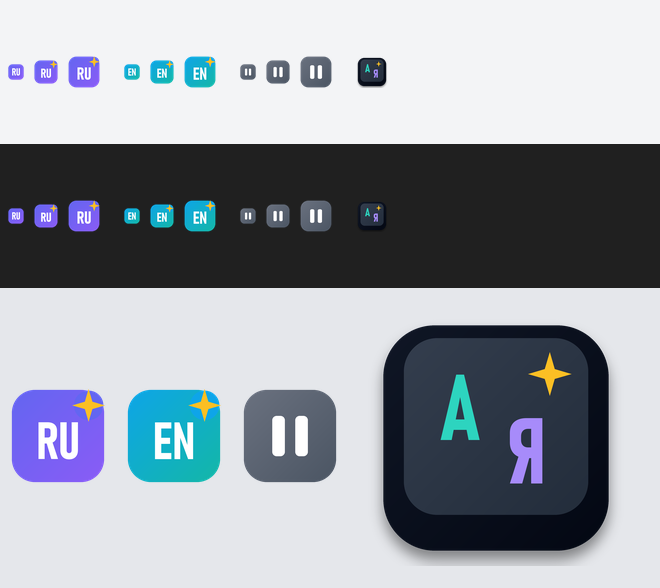

# AntiPunto

[](https://github.com/oops1/AntiPunto/actions/workflows/ci.yml)
[](https://github.com/oops1/AntiPunto/releases/latest)
[](https://github.com/oops1/AntiPunto/releases)
[](#требования)
[](LICENSE)

Переключатель раскладки RU/EN для Windows, который решает **по смыслу фразы**, а не по одному слову,
и **исправляет опечатки** («преокт» → «проект»).
Решения принимают маленькие локальные нейросети: они работают на NPU (Intel AI Boost), а без него — на процессоре.
Ничего не уходит в сеть, набранный текст нигде не сохраняется.



## Чем отличается от Punto Switcher

| | Punto Switcher | AntiPunto |
|---|---|---|
| Решение | по словарю, слово за словом | нейросеть видит окно из последних слов |
| Короткие слова («в», «я», «d», «z») | почти всегда мимо | берут раскладку у соседей |
| Ретроактивная правка | нет | слово в начале фразы исправляется, когда стало ясно, на каком она языке |
| Ники, пути, хеши, команды | часто ломает | обучена их не трогать |
| Дневник набранного | есть | нет и не будет |

Пример: на клавиатуре набрано `ghbdtn? rfr ltkf& z d rehct?` → на экране `привет, как дела? я в курсе,`;
в русской раскладке набрано `залей код на пшерги` → `залей код на github`.

## Установка

Скачайте `AntiPunto-<версия>-setup.exe` со страницы [релизов](https://github.com/oops1/AntiPunto/releases).
Установка идёт в профиль пользователя, права администратора не нужны. Есть и портативный zip.

Значок в трее показывает раскладку активного окна (RU / EN, на паузе — ⏸).
Левый клик — пауза, правый — меню: устройство нейросети, исправление опечаток (вкл/выкл),
«не исправлять в этой программе», списки, автозапуск, проверка обновлений, выход.

**Backspace сразу после автоисправления** — отменить его, как на телефоне: слово вернётся как было
и больше не тронется. Если перед Backspace было любое другое нажатие или клик — обычное стирание.

**Двойной правый Ctrl** (или **Pause/Break**, если есть) — перевернуть последнее слово вручную;
сразу после автоисправления — отменить его.

**Орфография** (с 0.3.0): опечатки исправляются сразу после слова — «преокт» → «проект», «магазн» → «магазин».
Исправляется только то, в чём модель уверена; настоящие слова из словаря (в том числе редкие — «вентральный»),
жаргон и слова с заглавной буквы не трогаются. Отменить — тот же Backspace.
Выключить — пункт меню трея «Исправлять опечатки» (запоминается; словари выгружаются из памяти)
или ключ `--no-spell` на один запуск.

**Поля паролей** не исправляются никогда (определяются через UI Automation).

Раз в сутки программа проверяет новые релизы на GitHub; установщик скачивается только по вашему клику
и запускается после сверки SHA-256 с `SHA256SUMS.txt` релиза. Отключить проверку: `--no-update-check`.

### Списки: когда модель ошибается в одном и том же слове

Обычно списки пустые — модель справляется сама. Они нужны для редких слов, в которых она стабильно ошибается.
Это текстовые файлы в папке «Документы\AntiPunto», открываются из меню трея (**Списки**),
правка подхватывается сразу после сохранения, перезапуск не нужен. Одно слово или программа на строку.

**Пример со словом «шифт».** «Шифт» — нормальное русское слово, но редкое, и модель принимает его
за «iban», набранный в русской раскладке: вы печатаете «шифт», а на экране становится «iban».

| Что хотите | Куда записать | Что будет |
|---|---|---|
| Чтобы «шифт» просто не трогался | `ignore.txt`: `шифт` | «шифт» → остаётся «шифт» |
| Чтобы «шифт» не трогался **и** набранный по ошибке в английской раскладке «iban» сам становился «шифт» | `force.txt`: `шифт` | «шифт» → «шифт», «iban» → «шифт» |

- **`ignore.txt` — «не трогай».** Слово отсюда никогда не исправляется, даже если модель уверена.
  Подходит для ников, сокращений, жаргона.
- **`force.txt` — «вот как должно быть».** Записывайте слово так, как хотите видеть его на экране.
  Набрано правильно — защищено от модели; набрано не в той раскладке — исправляется всегда.
- **`programs.txt` — «здесь не работать».** Имя программы, например `game.exe`, — в ней AntiPunto ничего
  не исправляет. Быстрее всего добавить через меню трея: «Не исправлять в <программа>».

Разовую ошибку проще поправить сразу: **Backspace** после неудачного исправления или **двойной правый Ctrl**,
если слово не исправилось само.

## Требования

- Windows 10/11 x64.
- **NPU желателен, но не обязателен — AntiPunto работает на любом процессоре.**
  Если есть NPU (Intel Core Ultra с драйвером NPU), нейросеть работает на нём и не нагружает ядра;
  если нет — на CPU. Модель крошечная: одно решение занимает меньше миллисекунды в обоих случаях.
- Память: около 200 МБ, почти всё — среда OpenVINO, модели и словари орфографии.

## Ограничения

- Парольные поля не распознаются: исключения — по процессам (KeePass, 1Password, Bitwarden, mstsc и др.).
- В окнах, запущенных от администратора, исправление не работает, пока сама программа без прав администратора.
- Орфография пока исправляет опечатки в словах с маленькой буквы; согласование окончаний («красивый девушка») — в разработке.

## Сборка

```powershell
# клиент
cd client
cargo build --release

# дистрибутив, zip и установщик (нужны pip-пакет openvino и Inno Setup 6)
python -m pip install openvino==2026.4.1
./scripts/make-dist.ps1
./scripts/selftest.ps1
```

Обучение модели — в `train/` (Python, PyTorch); устройство и результаты — в [ARCHITECTURE.md](ARCHITECTURE.md).

## Ветки и релиз

- Работа идёт в `develop`; CI проверяет каждый push.
- `main` защищена: только через pull request из `develop` (merge commit), после зелёного CI;
  удалять ветку и переписывать историю нельзя.
- Релиз: поднять версию в `client/Cargo.toml` и описать её в [CHANGELOG.md](CHANGELOG.md) в `develop` →
  PR в `main` → тег `vX.Y.Z` на коммит в `main`.
  Тег запускает сборку на GitHub Actions: тесты, дистрибутив, самотест модели, установщик,
  `SHA256SUMS.txt` и публикация релиза; текст релиза берётся из раздела версии в CHANGELOG.md.
